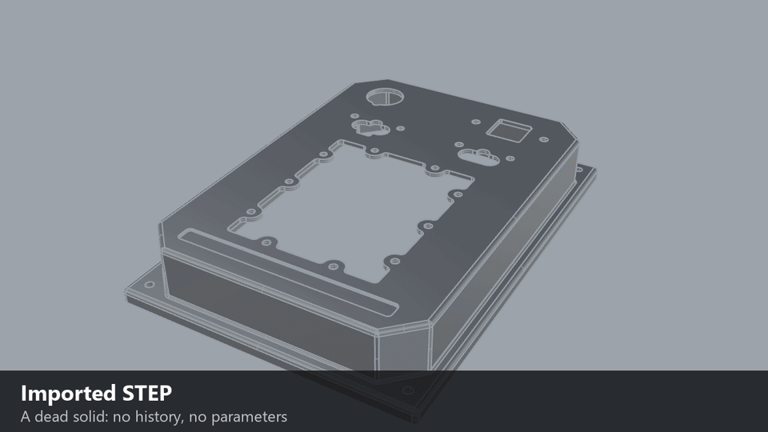
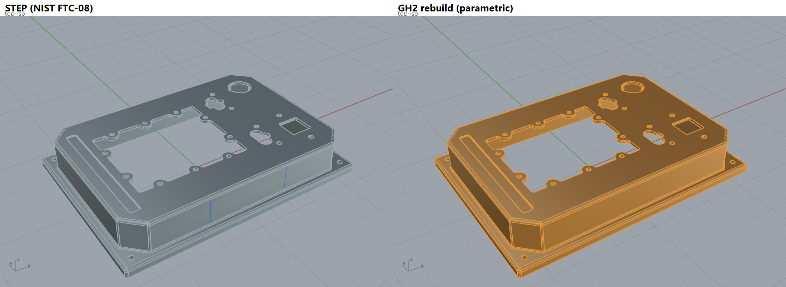
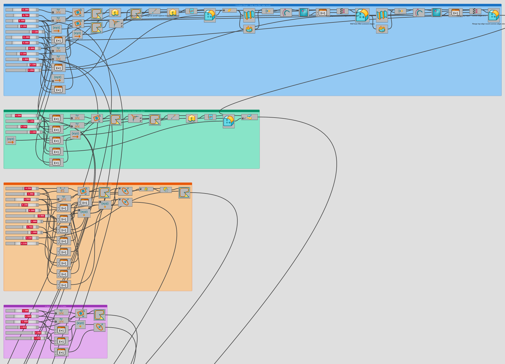

# rhino-ai-tools

**Claude rebuilds STEP parts as parametric Grasshopper 2 models, then proves them face by face.**



<sub>Every frame is a real Rhino 9 viewport capture driven over the Rhino MCP, and every slider frame is a live GH2 solve
checked for 247 faces and a valid solid. Rebuild it with [`docs/media/make_hero.py`](docs/media/make_hero.py)
([MP4](docs/media/hero.mp4)).</sub>

An LLM is good at writing a process and bad at being trusted with the result. These tools split the two jobs. Claude
builds the model once, a deterministic check verifies it against the original, and the same verified process runs every time.

| NIST FTC-08 rebuild | Result |
|---|---|
| Faces | **247 / 247** |
| Max deviation, both ways | **0.0019 mm** (0.000076 in, ~175,000 true-surface samples) |
| Volume | 30.7338 in³ (STEP 30.7336) |
| Area | +0.0018 % |
| Parameters | 63 named sliders in 12 feature groups |
| Slider tests | 15 changes across 9 sliders, all valid solids |

The part is [NIST's public PMI test model FTC-08](https://www.nist.gov/ctl/smart-connected-systems-division/smart-connected-manufacturing-systems-group/mbe-pmi-0),
so anyone can reproduce the numbers.

## Why
AI chat in CAD sees pixels, not the parametric model. An imported STEP has no history at all. **step-to-gh2** turns the
STEP into a parametric model whose sliders read like the drawing. **FeatureContext** then lets the AI edit that model's logic:
point at a face and it knows which component and sliders made it.

It started as a migration tool. A product line designed in another CAD system moved to Rhino and Grasshopper 2 without
remodelling by hand: each finalised part was exported as STEP and rebuilt as a verified parametric definition, ready
for the next design change.

## What's in the repo
| Path | What |
|---|---|
| [`skills/step-to-gh2/`](skills/step-to-gh2/SKILL.md) | Claude Code skill: the rebuild playbook plus Python scripts Claude runs inside Rhino |
| [`tools/FeatureContext/`](tools/FeatureContext/README.md) | Rhino commands `FeatureContext` and `FCBake`: trace a picked face back to its GH2 component and sliders |
| [`tools/ghz_sliders.py`](tools/ghz_sliders.py) | list a .ghz file's sliders (name, value, range) without Rhino |
| [`examples/nist-ftc08/`](examples/nist-ftc08/README.md) | the FTC-08 definition (.ghz), verification and machinability report |

## How step-to-gh2 works
1. **Measure** the STEP read-only: face census, sections, cylinder centres and arc radii (`analyze_brep.py`).
2. **Ask how it is made** (extrusion, turned, billet, sheet, moulded, printed). The process picks the sketch strategy.
3. **Plan the sliders** with the user, dimensioned like a drawing (offsets, pitches, counts), not raw coordinates.
4. **Build in Grasshopper 2** from native components, one verified stage at a time.
5. **Verify deterministically** (`compare_to_ref.py`): same face count, closed valid solid, deviation < 0.01 mm both ways,
   then sweep the sliders and re-check. Then run the **manufacturability checks**: 3-axis machinability (tool set, undercuts,
   reach, EDM corners) or SLS/MJF wall thickness.

Every problem hit on the FTC-08 build and its fix is in [`examples/nist_ftc08.md`](skills/step-to-gh2/examples/nist_ftc08.md).





## FeatureContext
Ctrl+Shift+click a face on the baked part and type what you want changed. FeatureContext walks back through the GH2 graph and
copies a summary for your AI:

```
Pick 1: face 166 of part "FTC-08 RESULT" - plane, area 0.132 in2, at [4.3, -1.4, 1.765], normal [0, -1, 0]
  Feature group: "4 Deck: square hole + G holes"
  Created by GH2 component "ExtrudeLinear" (ExtrudeLinear)
  Profile drawn by "FilletEntireCurve" (FilletEntireCurve)
  Chain: FTC-08 RESULT <- SolidDifference <- ExtrudeLinear
  Inputs of ExtrudeLinear (depth / span of the cut):
    Span: DeckT (top deck thickness) = 0.135
  Inputs of FilletEntireCurve:
    Curve: SquareSize = 1.1; SquareCY = -1.95; SquareCX = 4.3
    Radius: SquareCornerR = 0.0625
Request: make this hole 1.5 in square
```


It also writes a JSON packet and the highlighted screenshot, which the skill reads when you say "see packet".

## Requirements
- Windows, **Rhino 9 WIP** with **Grasshopper 2** (Rhino 8 can't run the GH2 parts)
- McNeel's Rhino MCP server (run `MCPStart` in Rhino)
- [Claude Code](https://claude.com/claude-code) for the skill. FeatureContext's summary works with any AI chat.

## Quick start
1. Copy `skills/step-to-gh2/` into your project's `.claude/skills/` (or `~/.claude/skills/`).
2. Set up the two FeatureContext aliases ([instructions](tools/FeatureContext/README.md#setup-once)).
3. **Set the Rhino document tolerance first** (Document Properties → Units). It should be at least 10× finer than the
   tightest tolerance on your drawing: **0.0001 in or 0.001 mm** works for typical machined parts. GH2 fillets and booleans
   run at this tolerance, and Rhino's inch template default (0.001 in) is too coarse. See [Limits](#limits).
4. In Rhino 9, start the MCP server, import a STEP and ask Claude: *"Rebuild this part as a parametric Grasshopper 2 definition."*
5. Or start from the FTC-08 example: [`examples/nist-ftc08/`](examples/nist-ftc08/README.md).

## Limits
- Prototype tools, tested on Rhino 9 WIP. GH2's API is still changing.
- FeatureContext follows parts moved with `Move`, not rotated ones, and only GH2 bakes made with `FCBake`.
- Rhino's kernel often fails when geometry exactly coincides (equal radii, coplanar faces in a union, a cutter on a hole
  of the same size). The skill nudges such cases by a small epsilon, e.g. 0.0001. The document tolerance is a modelling
  tolerance, not the part's machining tolerance, and it must be finer than both the drawing's tolerances and those
  nudges. FTC-08 rounds a flange edge at R0.1199 next to an R0.12 corner. At 0.001 in, Rhino treats the two as equal and
  the fillet fails silently (239 faces instead of 247). The face-count check is there to catch exactly this.
- The verification proves geometry, not intent. Read the slider plan before trusting a design change.

## Roadmap
This first release is step-to-gh2 and FeatureContext (plus `ghz_sliders.py`). Next: a Rhino 9 Cycles skill for photoreal bead-blasted anodised
aluminium (generated glint maps, checked numerically against reference photos), once it has a neutral example part.

## Credits
Built by Seamus Rowe on top of McNeel's [Rhino MCP server](https://www.rhino3d.com/) and Anthropic's
[Claude Code](https://claude.com/claude-code). The FTC-08 test part is published by NIST.

## License
[MIT](LICENSE)
