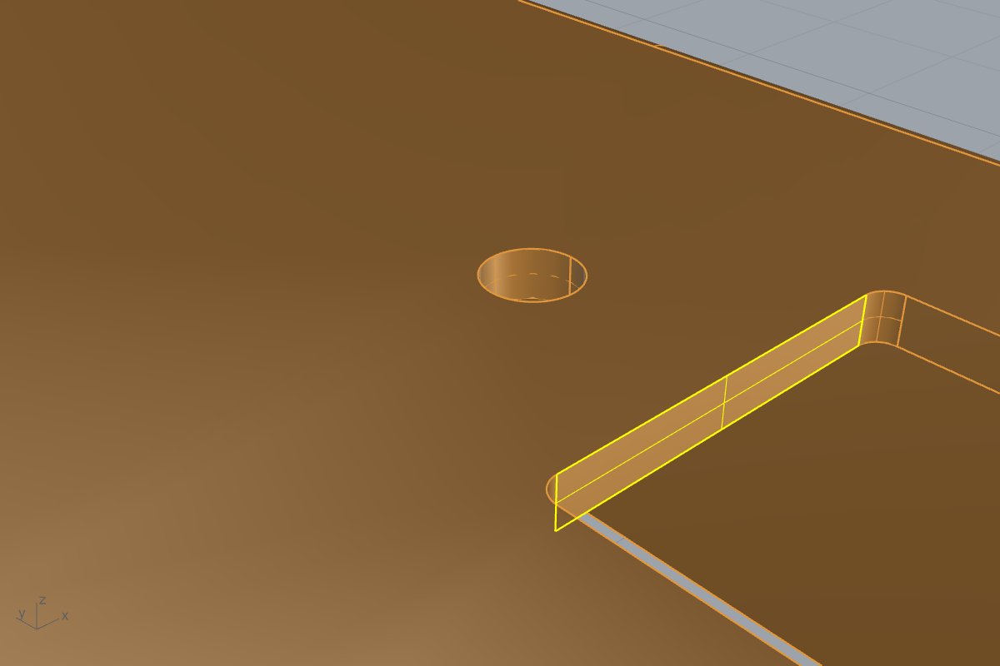

# FeatureContext: tell your AI which feature you mean

AI chat in Rhino sees the viewport, not your Grasshopper graph. FeatureContext closes that gap. You pick a face or edge on a
baked part and type what you want changed. It traces the face back through the Grasshopper 2 graph to the component and
sliders that made it, then hands your AI a text summary, a JSON packet and a screenshot with the pick highlighted.



Requires **Rhino 9 (WIP) with Grasshopper 2**.

## Files
| File | What |
|---|---|
| `FeatureContext.py` | the `FeatureContext` command: pick, type a request, write the packet |
| `FeatureContextBake.py` | the `FCBake` command: bake GH2 outputs with provenance tags |
| `fc_core.py` | tracing, baking and packet code (also importable from Claude's `run_python`) |

## Setup (once)
Put this folder anywhere, then add two aliases (Options → Aliases), using your own path:

| Alias | Command macro |
|---|---|
| `FeatureContext` | `! _-ScriptEditor _Run "<your folder>\FeatureContext\FeatureContext.py"` |
| `FCBake` | `! _-ScriptEditor _Run "<your folder>\FeatureContext\FeatureContextBake.py"` |

Optional: `fc_config.json` next to the scripts, `{"packets": "<folder>"}`, sends packets to a fixed folder.

## Use
1. Open your .3dm and the GH2 definition. Bake the part with `FCBake` (it offers named components with solid output, replaces
   earlier bakes only after asking, and tags the new objects).
2. Run `FeatureContext`. Ctrl+Shift+click one or more faces or edges, press Enter, and type your request
   (e.g. "make this a hard edge").
3. A summary is copied to the clipboard; paste it into your AI chat. For example, on the NIST FTC-08 example:
   ```
   Pick 1: face 166 of part "FTC-08 RESULT" - plane, area 0.132 in2, at [4.3, -1.4, 1.765], normal [0, -1, 0]
     Feature group: "4 Deck: square hole + G holes"
     Created by GH2 component "ExtrudeLinear" (ExtrudeLinear)
     Profile drawn by "FilletEntireCurve" (FilletEntireCurve)
     Chain: FTC-08 RESULT <- SolidDifference <- ExtrudeLinear
     Inputs of ExtrudeLinear (depth / span of the cut):
       Span: DeckT (top deck thickness) = 0.135
     Inputs of FilletEntireCurve:
       Curve: SquareSize = 1.1; SquareCY = -1.95; SquareCX = 4.3
       Radius: SquareCornerR = 0.0625
   Request: make this hole 1.5 in square
   ```
   A JSON packet (`<time>.json` + `latest.json`) and the highlighted screenshot go to `FeatureContext packets` next to the .3dm.
4. After you change sliders, re-bake with `FCBake`. A face that no longer exists in the current output is reported as STALE.

With Claude Code, the `step-to-gh2` skill knows to read `latest.json` when you say "see packet".

## How it works
Parts are baked with Grasshopper 2's own `BakeContext`, which stores the source component id on each object, plus some
`fc.*` metadata. For a picked face, the tool walks back through the GH2 graph to the first component whose output contains
that face, and follows a shared extrusion back to the step that drew that cut-out's outline. It then lists the sliders
driving it and the canvas group it belongs to.

## Limits (it is a prototype)
- Grasshopper 2 only; brep faces and edges.
- It follows parts moved with `Move` (and baked copies you move afterwards, via an `fc.offset` user-text tag), but not rotated ones.
- Objects baked before the tool existed, or in Rhino 8, carry no provenance: geometry only.
- Packets record the full path of your .ghz. Check them before sharing.
